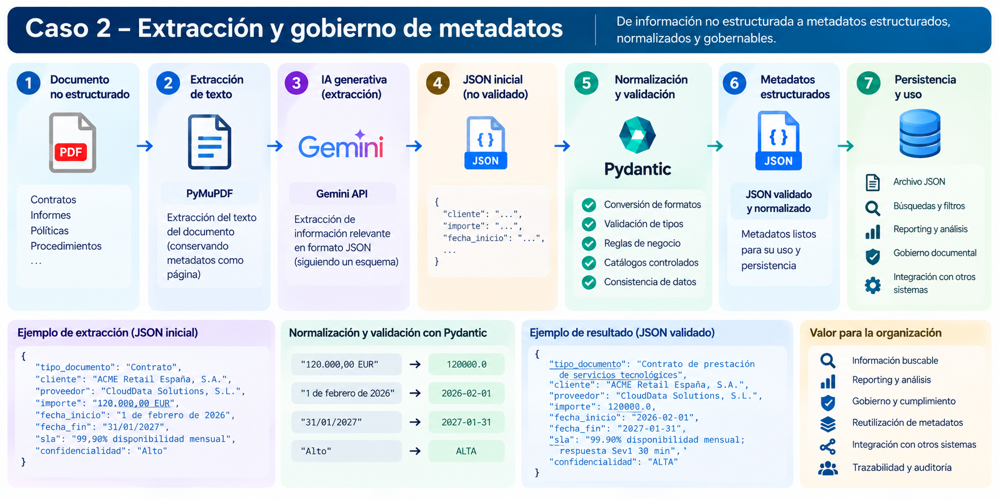

# Caso 2 - Extracción y gobierno de metadatos

## Objetivo

Transformar información contenida en documentos no estructurados en **metadatos estructurados, normalizados, validados y reutilizables**.

El caso de uso inicial trabaja con contratos PDF y extrae información relevante mediante IA generativa para convertirla posteriormente en datos gobernables.

El objetivo es pasar de:

```text
Documento
```

a:

```text
Documento
   |
   v
Información extraída
   |
   v
Metadatos estructurados
   |
   v
Datos gobernables
```

---

# Problema que resuelve

Los documentos contienen información relevante para la organización:

- cliente;
- proveedor;
- importe;
- fechas;
- SLA;
- confidencialidad;
- tipo documental;
- condiciones contractuales.

Mientras esa información permanece únicamente dentro de PDFs u otros documentos, resulta difícil:

- buscarla;
- filtrarla;
- analizarla;
- reutilizarla;
- integrarla con otros sistemas;
- aplicar reglas de gobierno;
- auditarla;
- utilizarla como filtro en sistemas RAG.

Este caso de uso busca convertir esa información no estructurada en **metadatos estructurados y validados**.

---

# Arquitectura



La arquitectura sigue el siguiente flujo:

```text
Documento PDF
     |
     v
Extracción de texto
     |
     v
Gemini
     |
     v
JSON inicial
     |
     v
Pydantic
     |
     v
Normalización
     |
     v
Validación
     |
     v
JSON persistente
```

---

# Flujo funcional

## 1. Documento no estructurado

El proceso parte de un documento PDF.

Ejemplos:

- contratos;
- informes;
- políticas;
- procedimientos;
- propuestas;
- documentación técnica.

En este prototipo se utiliza un contrato ficticio como documento de prueba.

---

## 2. Extracción de texto

PyMuPDF extrae el contenido textual del documento.

Ejemplo conceptual:

```text
Contrato PDF
     |
     v
PyMuPDF
     |
     v
Texto completo
```

El texto extraído se utiliza como entrada para el modelo generativo.

---

## 3. Extracción con Gemini

Gemini recibe el contenido del documento y un prompt estructurado con los campos que debe identificar.

Campos iniciales:

```text
tipo_documento
cliente
proveedor
importe
fecha_inicio
fecha_fin
sla
confidencialidad
```

Ejemplo de respuesta inicial del modelo:

```json
{
  "tipo_documento": "Contrato de prestación de servicios tecnológicos",
  "cliente": "ACME Retail España, S.A.",
  "proveedor": "CloudData Solutions, S.L.",
  "importe": "120.000,00 EUR",
  "fecha_inicio": "2026-02-01",
  "fecha_fin": "2027-01-31",
  "sla": "99.90% disponibilidad mensual; respuesta Sev1 30 min; resolución objetivo 4 h",
  "confidencialidad": "ALTO"
}
```

Esta salida todavía se considera **no validada**.

---

# Normalización y validación con Pydantic

Pydantic actúa como una capa entre la IA y el dato persistido.

El objetivo es evitar que los valores generados por el modelo se almacenen directamente sin control.

## Ejemplo: importe

Entrada:

```text
"120.000,00 EUR"
```

Salida:

```text
120000.0
```

## Ejemplo: confidencialidad

Entrada:

```text
"ALTO"
```

Salida normalizada:

```text
"ALTA"
```

## Ejemplo: fechas

Entrada:

```text
"2026-02-01"
```

Salida:

```text
datetime.date(2026, 2, 1)
```

---

# Modelo de datos

El esquema se define en:

```text
src/modelos.py
```

Modelo principal:

```python
class ContratoMetadata(BaseModel):
    tipo_documento: str
    cliente: Optional[str]
    proveedor: Optional[str]
    importe: Optional[float]
    fecha_inicio: Optional[date]
    fecha_fin: Optional[date]
    sla: Optional[str]
    confidencialidad: Optional[Confidencialidad]
```

---

# Reglas implementadas

Actualmente el modelo valida:

- que `tipo_documento` tenga contenido;
- que `importe` pueda convertirse a número;
- que el importe no sea negativo;
- que las fechas tengan formato válido;
- que `fecha_fin` no sea anterior a `fecha_inicio`;
- que la confidencialidad pertenezca a un catálogo controlado;
- que ciertos valores textuales se normalicen antes de almacenarse.

---

# Catálogo de confidencialidad

Se utiliza un catálogo controlado:

```text
BAJA
MEDIA
ALTA
```

El modelo puede normalizar variantes como:

```text
BAJO  -> BAJA
BAJA  -> BAJA

MEDIO -> MEDIA
MEDIA -> MEDIA

ALTO  -> ALTA
ALTA  -> ALTA
```

---

# Normalización del importe

Se soportan formatos como:

```text
120.000,00 EUR
120000,00
120000.00
120000
```

El objetivo es almacenar siempre un valor numérico homogéneo.

Ejemplo:

```text
"120.000,00 EUR"
        |
        v
120000.0
```

---

# Validación de fechas

Las fechas se convierten a tipos `date`.

Además se aplica una regla de consistencia:

```text
fecha_fin >= fecha_inicio
```

Si la fecha fin es anterior a la fecha inicio, Pydantic devuelve un error de validación.

---

# Persistencia

Una vez validados, los metadatos se almacenan en un fichero JSON.

Ejemplo:

```text
documentos/
├── contrato_prueba.pdf
└── contrato_prueba.metadata.json
```

Resultado:

```json
{
  "tipo_documento": "Contrato de prestación de servicios tecnológicos",
  "cliente": "ACME Retail España, S.A.",
  "proveedor": "CloudData Solutions, S.L.",
  "importe": 120000.0,
  "fecha_inicio": "2026-02-01",
  "fecha_fin": "2027-01-31",
  "sla": "99.90% disponibilidad mensual; respuesta Sev1 30 min; resolución objetivo 4 h",
  "confidencialidad": "ALTA"
}
```

---

# Scripts

Los principales scripts del caso de uso son:

```text
src/
├── modelos.py
├── extraer_metadatos.py
└── probar_metadatos.py
```

## `modelos.py`

Define:

- modelos Pydantic;
- tipos de datos;
- catálogos controlados;
- normalización;
- validaciones;
- reglas de negocio.

## `extraer_metadatos.py`

Ejecuta el flujo completo:

```text
PDF
 -> extracción de texto
 -> Gemini
 -> JSON
 -> Pydantic
 -> normalización
 -> validación
 -> persistencia
```

## `probar_metadatos.py`

Permite probar el modelo sin consumir Gemini.

Flujo:

```text
datos ficticios
 -> Pydantic
 -> normalización
 -> validación
 -> JSON
```

Este script es útil para probar reglas de calidad y persistencia de forma independiente.

---

# Configuración de Gemini

Crear un archivo `.env` en la raíz del proyecto:

```text
GEMINI_API_KEY=<API_KEY>
```

El archivo `.env` no debe versionarse.

Comprobar que `.gitignore` contiene:

```text
.env
```

---

# Dependencias

Las principales dependencias utilizadas son:

```text
pymupdf
pydantic
google-genai
python-dotenv
truststore
```

En algunos entornos corporativos, `truststore` puede ser necesario para utilizar el almacén de certificados de Windows.

---

# Ejecución

## Con Gemini

```powershell
python src\extraer_metadatos.py
```

El script:

```text
lee el PDF
 -> extrae el texto
 -> llama a Gemini
 -> obtiene JSON
 -> valida con Pydantic
 -> genera JSON persistente
```

---

## Sin Gemini

Para probar únicamente el modelo:

```powershell
python src\probar_metadatos.py
```

No realiza ninguna llamada a la API.

---

# Gestión de errores

El prototipo contempla errores como:

## Servicio temporalmente no disponible

```text
503 UNAVAILABLE
```

Se pueden realizar reintentos controlados.

## Cuota agotada

```text
429 RESOURCE_EXHAUSTED
```

En este caso el proceso debe detenerse, ya que un reintento inmediato no resolvería el problema.

## Respuesta vacía

Si Gemini no devuelve contenido válido, el proceso se detiene antes de intentar convertir el resultado a JSON.

---

# Valor desde gobierno de información

Este caso de uso permite convertir:

```text
información documental
```

en:

```text
metadatos estructurados
```

que pueden utilizarse para:

- búsqueda;
- filtros;
- reporting;
- catálogos documentales;
- auditoría;
- trazabilidad;
- clasificación;
- control de confidencialidad;
- integración con otros sistemas;
- filtros en soluciones RAG;
- reglas de retención;
- gobierno documental.

---

# Relación con el Caso 1 - RAG documental

Los dos casos de uso son complementarios.

## Caso 1

Permite:

```text
consultar el conocimiento contenido en los documentos
```

## Caso 2

Permite:

```text
estructurar y gobernar la información contenida en los documentos
```

Combinados:

```text
                   DOCUMENTOS
                       |
          +------------+------------+
          |                         |
          v                         v
        RAG                 Extracción metadata
          |                         |
          v                         v
Consulta conocimiento      Estructura información
          |                         |
          +------------+------------+
                       |
                       v
             Gestión documental IA
```

---

# Próximas mejoras

Las siguientes evoluciones previstas son:

- procesamiento de múltiples documentos;
- clasificación automática por tipo documental;
- detección automática de información sensible;
- metadatos de gobierno;
- propietario documental;
- fecha de extracción;
- estado de validación;
- versión del modelo utilizado;
- trazabilidad del prompt;
- persistencia en base de datos;
- almacenamiento en BigQuery o PostgreSQL;
- filtros de RAG por metadatos;
- integración con un catálogo documental;
- comparación de versiones;
- detección de duplicados;
- reglas de retención;
- interfaz web;
- arquitectura equivalente en GCP.

---

# Evolución hacia gobierno documental

Una posible evolución sería enriquecer los metadatos con información adicional:

```json
{
  "documento_origen": "contrato_prueba.pdf",
  "fecha_extraccion": "2026-10-15",
  "modelo_ia": "gemini",
  "estado_validacion": "VALIDADO",
  "propietario": "Compras",
  "clasificacion": "Contrato",
  "confidencialidad": "ALTA"
}
```

Esto permitiría incorporar conceptos como:

- lineage;
- ownership;
- clasificación;
- calidad;
- trazabilidad;
- auditoría.

---

# Objetivo de aprendizaje

Este caso de uso busca comprender cómo convertir:

```text
información no estructurada
```

en:

```text
información estructurada y gobernable
```

mediante:

```text
extracción
+
IA generativa
+
modelado
+
normalización
+
validación
+
persistencia
```

El objetivo es evolucionar progresivamente hacia un **gestor documental con IA** con capacidades de búsqueda, estructuración y gobierno de información no estructurada.
