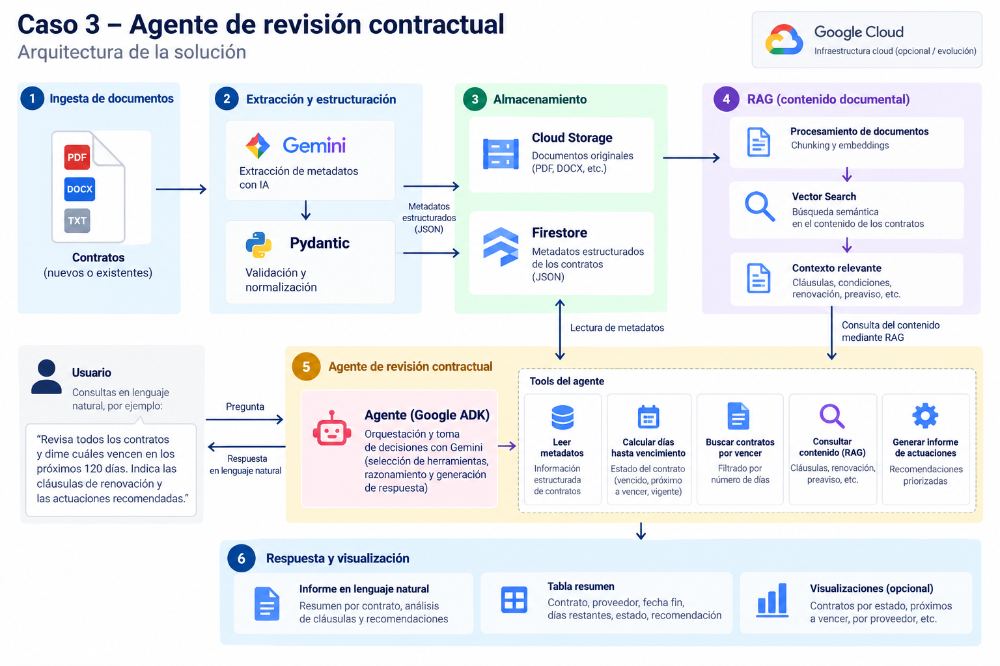

# Caso 3 - Agente de revisión contractual

## Objetivo

Construir un agente de IA capaz de **revisar contratos, combinar metadatos estructurados con información recuperada mediante RAG y generar recomendaciones de actuación**.

Este caso de uso reutiliza los dos casos anteriores:

- **Caso 1 - RAG documental**
- **Caso 2 - Extracción y gobierno de metadatos**

El agente actúa como una capa de orquestación que decide qué herramientas utilizar en función de la petición del usuario.

---

# Arquitectura


---

# Problema que resuelve

Una organización puede tener cientos o miles de contratos.

Revisarlos manualmente para identificar:

- vencimientos;
- renovaciones;
- preavisos;
- cláusulas relevantes;
- riesgos;
- obligaciones;
- contratos que requieren actuación;

puede ser costoso y poco escalable.

El objetivo es permitir consultas como:

```text
"Revisa todos los contratos y dime cuáles vencen
en los próximos 120 días."
```

o:

```text
"Comprueba si este contrato requiere actuación
y revisa las cláusulas de renovación o preaviso."
```

---

# Arquitectura



El agente combina información estructurada y no estructurada:

```text
                      USUARIO
                         |
                         v
                      AGENTE
                         |
          +--------------+--------------+
          |                             |
          v                             v
   Metadatos JSON                      RAG
          |                             |
          v                             v
fechas / proveedor / importe     cláusulas / contexto
          |                             |
          +--------------+--------------+
                         |
                         v
                Recomendación final
```

---

# Relación con los casos anteriores

## Caso 1 - RAG

Permite consultar contenido documental.

Ejemplo:

```text
¿Qué dice el contrato sobre renovación o preaviso?
```

## Caso 2 - Metadatos

Permite trabajar con información estructurada.

Ejemplo:

```json
{
  "proveedor": "CloudData Solutions, S.L.",
  "fecha_fin": "2027-01-31",
  "importe": 120000.0,
  "confidencialidad": "ALTA"
}
```

## Caso 3 - Agente

Combina ambos.

Ejemplo:

```text
Revisa el contrato.

1. Comprueba la fecha de vencimiento.
2. Calcula cuántos días quedan.
3. Consulta las cláusulas de renovación.
4. Determina si requiere actuación.
5. Justifica la recomendación.
```

---

# Flujo del agente

```text
Pregunta del usuario
        |
        v
Agente
        |
        v
¿Necesita metadatos?
        |
       Sí
        |
        v
leer_metadatos()
        |
        v
¿Necesita calcular vencimiento?
        |
       Sí
        |
        v
dias_hasta_vencimiento()
        |
        v
¿Necesita revisar cláusulas?
        |
       Sí
        |
        v
consultar_contrato_rag()
        |
        v
Combinar resultados
        |
        v
Respuesta final
```

---

# Tecnologías

- Python
- Google ADK
- Gemini
- RAG
- LM Studio
- Qwen3 4B Instruct
- PyMuPDF
- Sentence Transformers
- BM25
- JSON
- Pydantic
- truststore

---

# Estructura

```text
src/
└── agente/
    ├── __init__.py
    ├── agente.py
    ├── tools.py
    └── probar_agente.py
```

---

# Herramientas del agente

El agente dispone de varias tools.

## `leer_metadatos`

Lee los metadatos JSON asociados a un contrato.

```text
Contrato
   |
   v
JSON
   |
   v
cliente
proveedor
importe
fecha_fin
confidencialidad
...
```

---

## `dias_hasta_vencimiento`

Calcula los días restantes entre la fecha actual y la fecha de finalización del contrato.

Permite clasificar contratos como:

```text
VENCIDO
PRÓXIMO A VENCER
VIGENTE
```

---

## `consultar_contrato_rag`

Consulta el contenido completo del contrato mediante el RAG desarrollado en el Caso 1.

Se utiliza especialmente para buscar:

- renovación;
- preaviso;
- prórroga;
- cancelación;
- penalizaciones;
- obligaciones;
- cláusulas relevantes.

---

## `leer_todos_los_metadatos`

Lee múltiples archivos:

```text
*.metadata.json
```

de una carpeta.

Permite analizar varios contratos en una única petición.

---

## `contratos_por_vencer`

Filtra contratos según un número máximo de días hasta vencimiento.

Ejemplo:

```text
Contratos que vencen en <= 120 días
```

---

# Ejemplo de petición

```text
Revisa todos los contratos de la carpeta 'documentos'.

Identifica cuáles vencen en los próximos 120 días.

Distingue entre:
- contratos vencidos;
- contratos próximos a vencer;
- contratos vigentes.

Para los contratos próximos a vencer, revisa si existen
cláusulas de renovación, prórroga o preaviso y genera
un informe priorizado con las actuaciones recomendadas.
```

---

# Ejemplo de flujo multi-contrato

```text
leer_todos_los_metadatos()
        |
        v
contratos_por_vencer()
        |
        v
contratos relevantes
        |
        v
consultar_contrato_rag()
        |
        v
análisis de cláusulas
        |
        v
informe final
```

---

# Ejemplo de resultado

```text
Contrato: Finance Corp España

Proveedor:
TechOps Iberia, S.L.

Fecha fin:
15/12/2026

Días restantes:
60

Estado:
PRÓXIMO A VENCER

Cláusula relevante:
El contrato establece un preaviso de 90 días para evitar
la renovación automática.

Recomendación:
Revisar el contrato de forma prioritaria y confirmar
si se desea renovar, renegociar o cancelar.
```

---

# Multi-contrato

El agente también puede trabajar con varios contratos.

Ejemplo:

```text
documentos/
├── contrato_acme.metadata.json
├── contrato_finanzas.metadata.json
├── contrato_marketing.metadata.json
└── contrato_vencido.metadata.json
```

Esto permite ejecutar una revisión masiva.

---

# Clasificación temporal

Los contratos pueden clasificarse en:

## Vencido

```text
fecha_fin < hoy
```

## Próximo a vencer

```text
0 <= días_restantes <= límite
```

## Vigente

```text
días_restantes > límite
```

---

# Uso de RAG dentro del agente

Los metadatos no contienen todo el contenido contractual.

Por ejemplo, pueden indicar:

```json
{
  "fecha_fin": "2027-01-31"
}
```

pero no necesariamente contienen:

```text
"El contrato se renovará automáticamente salvo
preaviso de 90 días."
```

Por eso el agente combina:

```text
Metadatos
+
RAG
```

para construir una respuesta más completa.

---

# Modelo de agente

El agente se define en:

```text
src/agente/agente.py
```

Utiliza Google ADK y Gemini para:

- interpretar la petición;
- seleccionar tools;
- decidir el orden de ejecución;
- combinar resultados;
- generar una respuesta final.

---

# Ejecución

Antes de ejecutar el agente:

1. Activar el entorno virtual.
2. Tener configurada la API key de Gemini.
3. Arrancar LM Studio.
4. Cargar el modelo utilizado por el RAG.
5. Activar el servidor local de LM Studio.

Ejemplo:

```powershell
python -m src.agente.probar_agente
```

---

# Dependencias externas

## Gemini

Se utiliza como modelo de decisión y orquestación del agente.

Puede estar sujeto a límites de cuota.

Ejemplo de error:

```text
429 RESOURCE_EXHAUSTED
```

## LM Studio

Se utiliza en el RAG para generar respuestas basadas en el contexto recuperado.

Servidor:

```text
http://localhost:1234/v1
```

---

# Manejo de errores

## Cuota de Gemini agotada

```text
429 RESOURCE_EXHAUSTED
```

En este caso debe esperarse al reinicio de cuota o utilizar otro modelo disponible.

## LM Studio no disponible

Si el servidor local no está activo:

```text
ConnectionError
localhost:1234
```

Debe arrancarse el servidor local de LM Studio.

## Certificados corporativos

En determinados entornos puede aparecer:

```text
SSL: CERTIFICATE_VERIFY_FAILED
```

El proyecto utiliza:

```python
import truststore
truststore.inject_into_ssl()
```

para utilizar el almacén de certificados del sistema.

---

# Valor del caso de uso

El agente permite pasar de:

```text
consultar información
```

a:

```text
analizar
+
decidir
+
orquestar herramientas
+
proponer acciones
```

La diferencia principal respecto a un chatbot es que el agente puede utilizar varias herramientas para resolver una tarea.

---

# Evolución hacia una arquitectura cloud

Actualmente:

```text
JSON local
+
PDF local
+
RAG local
+
Gemini
```

Una posible evolución sería:

```text
Cloud Storage
     |
     v
PDF originales

Firestore
     |
     v
metadatos estructurados

Vector Search / RAG
     |
     v
contenido documental

Google ADK + Gemini
     |
     v
Agente contractual
```

---

# Posible integración con Firestore

En lugar de leer archivos JSON locales:

```text
contrato_acme.metadata.json
```

el agente podría consultar una colección:

```text
contratos
```

en Firestore.

Ejemplo:

```text
contratos/
├── contrato_acme
├── contrato_finanzas
└── contrato_marketing
```

Esto permitiría:

- búsquedas centralizadas;
- filtros;
- escalabilidad;
- integración con otros sistemas;
- arquitectura cloud.

---

# Próximas mejoras

- almacenar metadatos en Firestore;
- almacenar documentos en Cloud Storage;
- consultar múltiples PDFs de forma dinámica;
- relacionar cada JSON con su PDF correspondiente;
- priorizar contratos según riesgo;
- generar tablas resumen;
- guardar informes generados;
- incorporar trazabilidad de tools utilizadas;
- registrar prompts y respuestas;
- añadir revisión humana;
- incorporar clasificación de riesgos;
- integrar con correo o sistemas de notificación;
- generar alertas de vencimiento;
- desplegar el agente en Google Cloud.

---

# Objetivo de aprendizaje

Este caso de uso permite entender cómo evolucionar desde:

```text
LLM
```

a:

```text
Agente
```

capaz de utilizar herramientas.

El flujo completo del proyecto queda:

```text
CASO 1
RAG
 |
 +------------------+
                    |
                    v
                  AGENTE
                    ^
                    |
 +------------------+
 |
CASO 2
Metadatos
```

El objetivo final es construir un **gestor documental con IA** capaz de:

```text
consultar
+
estructurar
+
gobernar
+
analizar
+
actuar
```

sobre información no estructurada.
